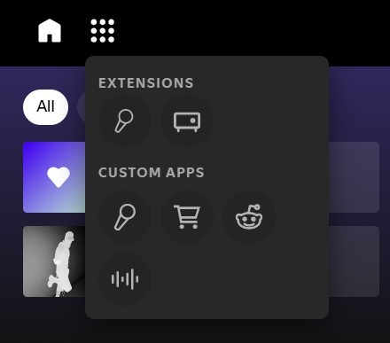

# Organize Apps and Extensions

A [Spicetify](https://spicetify.app/) extension that combines installed extensions and custom apps into a single dropdown in Spotify's navigation bar.

## Preview

<p align="center">
	
</p>

## Features

- Groups all installed Spicetify extensions in one menu.
- Includes Spicetify custom apps.
- Shows tooltips using each button's `aria-label`.
- Supports mouse hover and keyboard focus.
- Closes the menu after selecting an item.
- Adds a subtle open and close transition.


## Installation

Install the extension through the Spicetify Marketplace (search for "Organize Apps and Extensions"), or install it manually from
the repository's **Releases** page:

1. Download `organize-apps-and-extensions.js` from the release assets.
2. Copy it into your Spicetify `Extensions` directory. (You can find it in `%APPDATA%\spicetify\Extensions`)
3. Inside the directory, run the following in your terminal:

```
spicetify config extensions organize-apps-and-extensions.js
```

4. Run `spicetify apply`.
5. Restart Spotify.

## Development

Install dependencies:

```powershell
npm install
```

Build a minified bundle:

```powershell
npm run build-local
```

The compiled file is written to `dist/`.

## License

MIT
